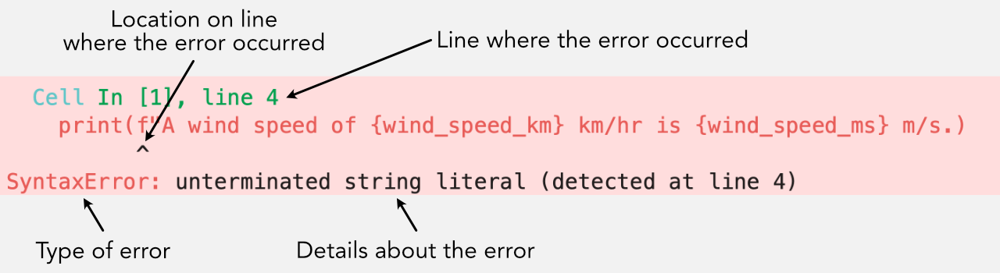

---
jupyter:
  jupytext:
    text_representation:
      extension: .md
      format_name: markdown
      format_version: '1.3'
      jupytext_version: 1.19.5
  kernelspec:
    display_name: Python 3 (ipykernel)
    language: python
    name: python3
---

# Testing and debugging your code

<!-- #region tags=["raises-exception"] -->
## Interpreting error messages

In the book we have encountered a number of different types of error messages that can arise in Python, but have not really discussed how to understand what the computer is trying to tell you when you get an error message.
We'll do that here.
For most Python errors you will see and exception raised when the error is encountered, providing some insight into what went wrong and where to look to fix it.
<!-- #endregion -->

### Reading error messages

Let's imagine you've written the code below called to convert wind speeds from km/hr to m/s and you're dying to figure out how windy it is in [Halifax, Nova Scotia, Canada](https://www.theweathernetwork.com/ca/weather/nova-scotia/halifax) where they report wind speeds in km/hr.

Unfortunately, when you run execute your code you observe the following:

```python tags=["raises-exception"]
wind_speed_km = 50
wind_speed_ms = wind_speed_km * 1000 / 3600

print(f"A wind speed of {wind_speed_km} km/hr is {wind_speed_ms} m/s.)
```

Let's break this example down and see what the error message says.



*A SyntaxError, annotated*

As you can see, there is quite a bit of useful information here. We have some information about the code cell that was run, as well as which line of the cell was a problem. We also have the type of error, a [`SyntaxError`](https://docs.python.org/3/tutorial/errors.html#syntax-errors) in this case, where it occurred on the line, and a bit more information about its meaning. The location on the line won't always be correct, but Python makes its best guess for where you should look to solve the problem. In this case, we can see that our f-string is missing the second set of quotation marks.

Let's consider another example, where you have fixed the `SyntaxError` above and now have made a function for calculating a wind speeds in m/s.

When you run this script you encounter a new and longer error message:

```python tags=["raises-exception"]
def convert_wind_speed(speed):
    return speed * 1000 / 3600


wind_speed_km = "30"
wind_speed_ms = convert_wind_speed(wind_speed_km)

print(f"A wind speed of {wind_speed_km} km/hr is {wind_speed_ms} m/s.")
```

In this case we see a [`TypeError`](https://docs.python.org/3/builtins/exceptions.html#TypeError) that is part of a *{term}`traceback <Traceback>`*, where the problem in the code arises from something other than on the line where the code was run. In this case, we get a `TypeError` where we try to divide a character string by a number, something Python cannot do. Hence, a `TypeError` is raised, indicating the data types are not compatible. That error, however, does not occur when the code is run until the point where the function is used. Thus, we see the traceback showing that not only does the error occur when the function is called, but also that the problem is in the function definition (note the two arrows indicating the problematic lines).

The traceback above may look a bit scarier, but if you take your time and read through what is output you will again find that the information is helpful in finding the problem in your code. After all, the purpose of the error message is to help the user find a problem :).

```{admonition} Error messages in Python 3.10 and newer

The Python environment for this book uses Python 3.12 which was first released in October 2023. It includes changes to [improve error messages](https://docs.python.org/3.10/whatsnew/3.10.html#better-error-messages) that were part of the release of Python 3.10 two years earlier.
```


### Common errors and exceptions

Now that we have some idea of how to read an error message, let's have a look at a few different types of common Python exceptions that are displayed for different program errors.

#### IndexErrors

An [`IndexError`](https://docs.python.org/3/builtins/exceptions.html#IndexError) occurs when you attempt to reference a value with an index outside the range of index values.
We can easily produce an `IndexError` by trying to access the value at index 5 in the following list of cities: `cities = ['Paris', 'Berlin', 'London']`.

```python
cities = ["Paris", "Berlin", "London"]
```

```python tags=["raises-exception"]
cities[5]
```

Here we get the rather clear error message that the index used for the list `cities` is outside of the range of index values for that list.


#### NameErrors

A [`NameError`](https://docs.python.org/3/builtins/exceptions.html#NameError) typically occurs when you reference a variable that has not been defined. We can produce a `NameError` by trying `station_id = stations[1]`.

```python tags=["raises-exception"]
station_id = stations[1]
```

In this instance we receive a `NameError` because the list `stations` has not been defined, and we're thus not able to access a value in that list.


#### IndentationErrors

An [`IndentationError`](https://docs.python.org/3/builtins/exceptions.html#IndentationError) is raised whenever a code block is expected to be indented and is either (1) not indented or (2) is indented inconsistently. Let's demonstrate this using two examples below.

```python tags=["raises-exception"]
for city in cities:
    city = city + " is a city in Europe"
  print(city)
```

```python tags=["raises-exception"]
for city in cities:
city = city + " is a city in Europe"
print(city)
```

In both of the examples above, an `IndentationError` is raised. In the first case, the indentation level is inconsistent. In case two, indentation is expected for the code on the line(s) after a `for` statement.


#### TypeErrors

A [`TypeError`](https://docs.python.org/3/builtins/exceptions.html#TypeError) is raised whenever incompatible data types are used together. For example, if we try to divide a character string by a number or add a number to a boolean variable, a `TypeError` will be raised.

```python tags=["raises-exception"]
cities[0] / 5
```

In this case, the `TypeError` is raised because it is not possible to divide a character string by a number.


#### Other kinds of errors

There are certainly [other kinds of errors and exceptions in Python](https://docs.python.org/3/tutorial/errors.html), but this list comprises those you're most likely to encounter.
As you can see, knowing the name of each error can be helpful in trying to figure out what has gone wrong, and knowing what these common error types mean will save you time trying to debug your programs.


### More information on errors

You can find a bit more information about interpreting error messages on the [Software Carpentry](https://swcarpentry.github.io/python-novice-inflammation/09-errors.html) and [Python Software Foundation](https://docs.python.org/3/tutorial/errors.html) webpages.


## Using assertions

[Defensive programming](https://en.wikipedia.org/wiki/Defensive_programming) aims to maximize the reliability and overall quality of a piece of software. For us, this means that we should take steps to handle unexpected input values in our code and to provide helpful error messages that provide guidance to the user when a program raises an exception. We can take steps toward writing more reliable software by utilizing a helpful features in Python: Assertions.

### Assertions

*{term}`Assertions <Assertion>`* are a way to assert, or ensure, that the values being used in your scripts are going to be suitable for what the code does. Let's start by considering a function called `convert_kph_ms()` that converts wind speeds from kilometers per hour to meters per second. We can define and use the function in the cell below.

```python
def convert_kph_ms(speed):
    """Converts velocity (speed) in km/hr to m/s"""
    return speed * 1000 / 3600


wind_speed_km = 9
wind_speed_ms = convert_kph_ms(wind_speed_km)

print(f"A wind speed of {wind_speed_km} km/hr is {wind_speed_ms} m/s.")
```

This all seems fine but perhaps you want to ensure that the values for the wind speed are not negative numbers, since speed is the magnitude of the wind velocity and should always be positive or zero. An assertion can be used to enforce this condition by adding an `assert` statement to the function.

```python
def convert_kph_ms(speed):
    """Converts velocity (speed) in km/hr to m/s"""
    assert speed >= 0.0
    return speed * 1000 / 3600


wind_speed_km = 9
wind_speed_ms = convert_kph_ms(wind_speed_km)

print(f"A wind speed of {wind_speed_km} km/hr is {wind_speed_ms} m/s.")
```

OK, so everything still works when using a positive value for `speed` but what happens if a negative value is given for the wind speed?

```python
wind_speed_km = -27
wind_speed_ms = convert_kph_ms(wind_speed_km)

print(f"A wind speed of {wind_speed_km} km/hr is {wind_speed_ms} m/s.")
```

Now we get an [`AssertionError`](https://docs.python.org/3/builtins/exceptions.html#AssertionError) when a negative value is provided. This `AssertionError` is produced because of the `assert` statement in the function definition. If the condition listed after `assert` is `False`, an `AssertionError` will be raised when the code is executed.

This is a definite improvement compared to the first example using the `convert_kph_ms()` function, however it would be much better to provide the user with some information about why this assertion exists. Fortunately, we can do this simply by adding some text after the condition in the assertion.

```python
def convert_kph_ms(speed):
    """Converts velocity (speed) in km/hr to m/s"""
    assert speed >= 0.0, "Wind speed values must be positive or zero"
    return speed * 1000 / 3600


wind_speed_km = -27
wind_speed_ms = convert_kph_ms(wind_speed_km)

print(f"A wind speed of {wind_speed_km} km/hr is {wind_speed_ms} m/s.")
```

<!-- #region -->
Nice! Now we see that when the `AssertionError` is raised, the message informs us about why it happened without having to interpret the code. The message also makes it easy to fix our value for `wind_speed_km` to work with the `convert_kph_ms()` function.

In general, assertions take the following form:

```python
assert <some condition>, "Error message to display"
```

So they start with an `assert` statement, then list a logical test for some condition, and optionally have a text string that follows the condition, separated by a comma. If the test evaluates as `True` then nothing happens and the code continues. Otherwise, the code stops, an `AssertionError` is displayed, and any included text is written to the screen.
<!-- #endregion -->

### Multiple assertions: a bad example

Of course, you may want to have several assertions in a function in order to ensure it works as expected and provides meaningful output. In our case, we might first want to check that the value provided for conversion from km/hr to m/s is a number. If it is not, we would not be able to convert the units properly. Let's add a second assertion to make sure our function is "safe".

```python
def convert_kph_ms(speed):
    """Converts velocity (speed) in km/hr to m/s"""
    assert (
        type(speed) == int or type(speed) == float
    ), "Wind speed values must be numeric"
    assert speed >= 0.0, "Wind speed values must be positive or zero"
    return speed * 1000 / 3600


wind_speed_km = "dog"
wind_speed_ms = convert_kph_ms(wind_speed_km)

print(f"A wind speed of {wind_speed_km} km/hr is {wind_speed_ms} m/s.")
```

OK, so that works. Now, if the user attempts to give a data type that is not `int` or `float`, the function will raise an `AssertionError` indicating a number is expected for the function to work. This is OK, however there are reasons why it is better not to include assertions of this type in a function.

```{warning}
You might think that it would be useful to use an assertion to check the type of `speed` in our function in order to avoid getting a `TypeError` if an incompatible data type is provided. However, this is not really a good idea because the exact purpose of a `TypeError` to indicate you have incompatible data types. Thus is makes no sense to include an assertion and raise an `AssertionError` to do the same thing. Thus, it is better to allow the code to fail with a `TypeError` in such cases and reserve the assertions for testing values that should be used or produced by the code and may not raise an exception otherwise.
```


### Multiple assertions: a better example

So we might not want to check our data type compatibility using assertions, but we can include a second assertion to ensure the input wind speed is a reasonable number. In this case, we can assume that the wind speed being converted was measured on Earth, and thus should be lower than [the fastest wind speed ever measured](https://en.wikipedia.org/wiki/Wind_speed#Highest_speed), 408 km/hr. Let's add that condition.

```python
def convert_kph_ms(speed):
    """Converts velocity (speed) in km/hr to m/s"""
    assert speed >= 0.0, "Wind speed values must be positive or zero"
    assert speed <= 408.0, "Wind speed exceeds fastest winds ever measured on Earth"
    return speed * 1000 / 3600


wind_speed_km = "409"
wind_speed_ms = convert_kph_ms(wind_speed_km)

print(f"A wind speed of {wind_speed_km} km/hr is {wind_speed_ms} m/s.")
```

This is a better example for two reasons:

1. We now allow a `TypeError` when incompatible data types are used in our function, which is a clear and familiar error message.
2. We use assertions to check the values used in the function make sense for its intended use. If we want to help users convert wind speeds on Earth, we provide bounds that make sure they are using reasonable input values. Thus, we help them use our function the correct way.

Combined, these assertions ensure our function handles common mistakes and provide the user with helpful feedback to be able to use the function properly.

```{note}
One thing that is important to note about assertions is that although we use them here to check that our function input values are reasonable, this is not generally the suggested use. Instead, more advanced programmers typically use assertions only to test that your code is working properly internally. For example, you would use assertions to check for things that should not happen, such as functions that duplicate values in lists when they should not. One reason it is not recommended to use assertions for testing user input values or the existence of files is that assertions can be disabled using flags when running a Python program. Thus, it is possible they could be ignored entirely. This is fine when debugging code, but obviously not desired when users are running your programs. If you're interested in more details, you can find more in [an article on using assertions in the Python wiki](https://wiki.python.org/moin/UsingAssertionsEffectively) or on the [Software Carpentry website](https://swcarpentry.github.io/python-novice-inflammation/10-defensive.html).
```


## Debugging your Python code

Debugging your code can be time consuming, and probably already uses most of the time you devote to working on it. There is no way to avoid spending time fixing bugs, especially when you're learning to program and simply may not yet know how to solve a given programming problem. That said, there are ways to be more effective when debugging, which can save you time and frustration. Below, we review some tips for debugging.

This lesson is based in part on the [Software Carpentry group's lesson on debugging](https://swcarpentry.github.io/python-novice-inflammation/11-debugging.html).

### General recommendations

Our main recommendations for debugging your Python codes are:

1. Test your code with known outputs
2. Make your code crash quickly and regularly
3. Make small changes and track them

We expand on these points further in the text below.


### Test your code with known outputs

One of the biggest challenges to debugging your code once you solve the syntax issues is knowing whether or not the code actually works like it should. In order to be able to assess this, we need to know the "answer" the code should produce. In many cases this means *some form* of calculating a known value using simplified data or test cases.

#### Testing with a simplified data file

Let's consider an example of calculating the maximum difference in daily temperature in Helsinki using observations for the past 50 years. First off, we don't know the answer in advance so we cannot simply work on the code until it gives the expected temperature difference. Secondly, we can expect that we should have more than 18 000 observations in our data file for the past 50 years, so it will be hard to confirm we get the right answer because of the size of the dataset. One thing that can be helpful here is to test your program using some small subset of the data. For instance, we could take the top 5 lines of data from the file, which might look like the following:

```
STATION           ELEVATION  LATITUDE   LONGITUDE  DATE     PRCP     TAVG     TMAX     TMIN     
----------------- ---------- ---------- ---------- -------- -------- -------- -------- -------- 
GHCND:FIE00142080         51    60.3269    24.9603 19520101 0.31     37       39       34       
GHCND:FIE00142080         51    60.3269    24.9603 19520102 -9999    35       37       34       
GHCND:FIE00142080         51    60.3269    24.9603 19520103 0.14     33       36       -9999    
GHCND:FIE00142080         51    60.3269    24.9603 19520104 0.05     29       30       25       
GHCND:FIE00142080         51    60.3269    24.9603 19520105 0.06     27       30       25     
```

From this, we know two things:

1. We should expect the code to be able to handle no data values equal to `-9999`, and to not include days with no data values when calculating the maximum temperature difference (`TMAX` - `TMIN`).
2. The maximum temperature difference if we test our code with this data file should be 5°.

In this case, we now know that if we can get our code to return the correct answer with the small test file, perhaps the same can be done for the full dataset. In other cases, we may actually know the expected answer, in which case debugging should be a bit easier.


### Make your code crash quickly and regularly

This may sound silly, but it is a good thing when your code crashes the same way every time you run it. If you have different behaviors when you run your code several times without making changes to the code, it will be much more difficult to isolate the source of the problem. What we ideally want in a code is to see behavior that is **consistent**.

In addition, if you expect to debug your program efficiently, you can't afford to wait 30 minutes every time you run it in order for it to crash. If your code crashes when processing a massive data file, you can consider testing with some smaller part of the file. Does the code still crash? If not, why not? Are there some parts of the code that seem to run just fine every time? If you can reduce the time needed for a crash, and isolate where in the code the problem lies (perhaps in memory if you're dealing with really large datasets), you will save yourself time debugging.


### Make small changes and track them

We're teaching you to use [GitHub.com](https://github.com/) to store your work, and to commit your changes regularly. This is for two reasons. First, by keeping track of the changes, you will have a better chance of isolating a problem if you find that suddenly your code doesn't work. You can simply go back to a version of the code that worked and look at what has changed in the version that doesn't work. **This is probably the greatest thing about version control**. Secondly, if you make small changes to the code it is easier to see exactly what changed and where. When it comes to debugging, this is one of the keys to solving problems quickly.

It is worth noting that often we don't keep track and commit every single small change to our codes, but rather commit when things are working as we expected. This means that when you debug, you might not keep track of every little change you make. This is fine, but it is important when you are debugging that you make small changes in one part of the code, then re-test. You should change one thing at a time, test the code, and make more changes if needed. Changing several things at once might be appealing, but it will make it harder to see exactly what is causing the problem because you can't isolate the issue to a single line of the program.
